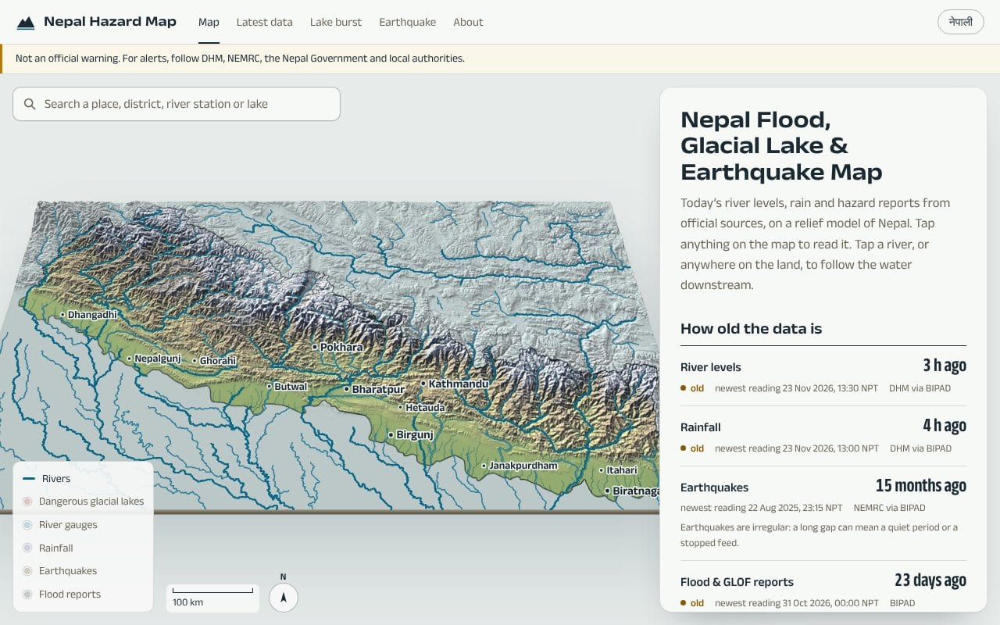
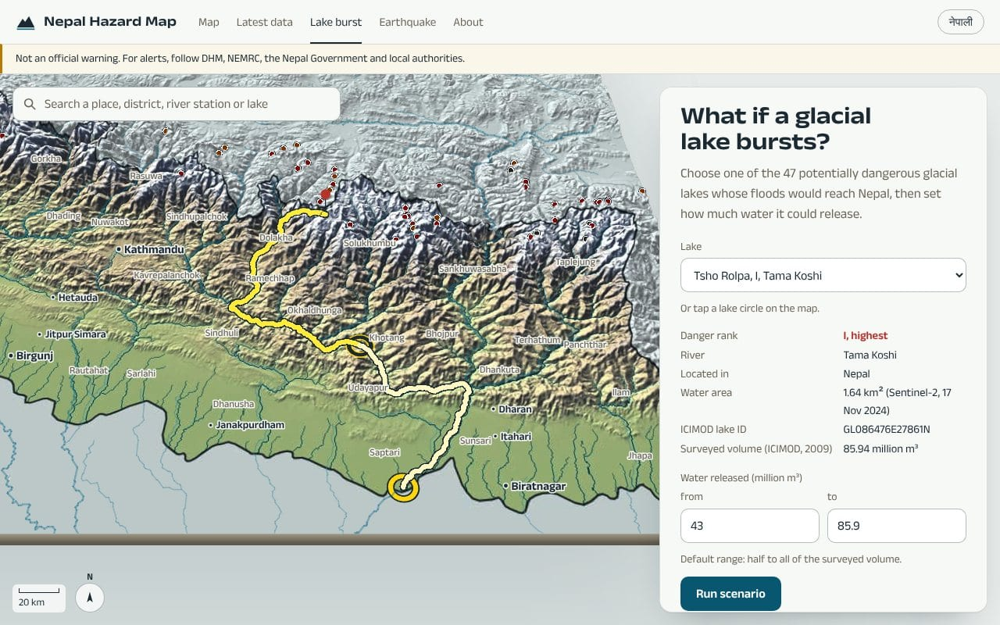
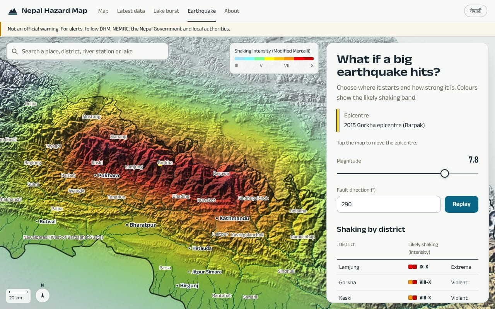
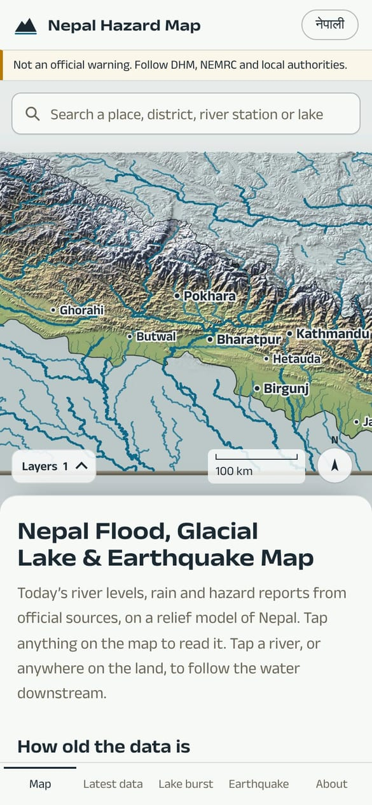
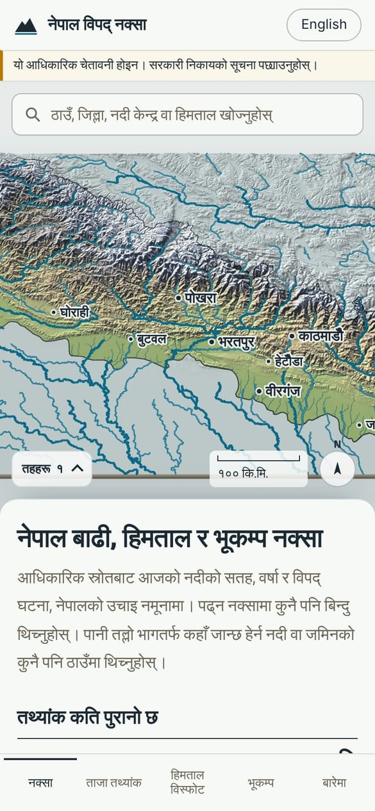
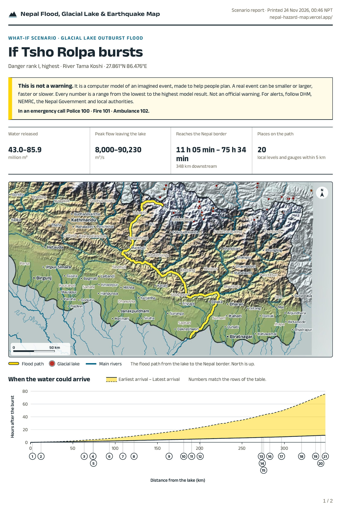
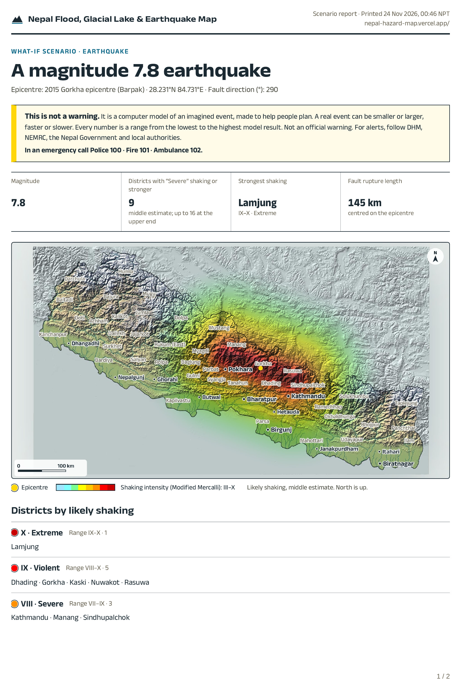

# Nepal Flood, Glacial Lake & Earthquake Map

[](https://github.com/prasidupadhya/nepal-hazard-map/actions/workflows/ci.yml)
[](https://github.com/prasidupadhya/nepal-hazard-map/actions/workflows/daily.yml)
[](LICENSE)

**[nepal-hazard-map.vercel.app](https://nepal-hazard-map.vercel.app)** · English and नेपाली

A free website that shows today's official river levels, rainfall, earthquakes
and flood reports for Nepal on a 3D relief map, and lets anyone try "what if"
scenarios for glacial lake outburst floods and earthquakes. It is fast on cheap
phones, works in both languages, and prints a clean report.

> [!IMPORTANT]
> **This is not an official warning.** For alerts, follow DHM, NEMRC, the
> Nepal Government and local authorities. In an emergency call Police 100,
> Fire 101 or Ambulance 102.



## What it does

- **Latest data, copied every morning** from DHM, NEMRC and the BIPAD portal.
  Every dataset shows how old it is, and a failed copy keeps the previous one
  and says so.
- **3D relief map** (three.js) of the whole country with rivers, place names,
  search by district, local level, river station or lake, and sharp close-up
  terrain when you zoom in.
- **Trace any river downstream** to the Nepal border: tap a river, a gauge or
  anywhere on the land.
- **What if a glacial lake bursts?** All 47 potentially dangerous glacial lakes
  that would flood Nepal (ICIMOD 2020), each with a volume range. The flood is
  routed down the river to the Nepal border with arrival times, peak flow and
  water depth as ranges.
- **What if a big earthquake hits?** Choose the epicentre, magnitude and fault
  direction; see the likely shaking band for all 77 districts.
- **Printable reports:** a north-up map with scale and legend, key figures, an
  arrival-time chart, and the full table, on two A4 pages.
- **Works offline and installs like an app.** After one visit the site opens
  without a connection, showing the copy saved on the phone with its age; a
  lake or river looked at before still runs. Add it to the home screen from the
  browser menu.
- **Works on every phone:** no WebGL? The data and scenarios still work and
  the map says why. Data can't load? A clear message and a retry button.
- **Rust → WebAssembly** scenario engine, kept identical to the JavaScript
  reference by tests.

| Lake burst | Earthquake |
|---|---|
|  |  |

**On a phone, in both languages**

<p> </p>

**Printed reports** (page 1 of 2; click for full size)

<p><a href="docs/img/print-glof.jpg"></a> <a href="docs/img/print-quake.jpg"></a></p>

## Where the data comes from

| What | Source | How |
|---|---|---|
| River levels, rainfall | DHM (hydrology.gov.np) | BIPAD public API, copied daily |
| Earthquakes | NEMRC (seismonepal.gov.np) | BIPAD public API, copied daily |
| Flood and GLOF reports | BIPAD (bipadportal.gov.np) | copied daily, archived by month |
| Districts | Constitution of Nepal, Schedule 4 | `src/districts.js` |
| Terrain | AWS Terrain Tiles (SRTM and others); Natural Earth outline | baked once by `scripts/bake-terrain.js` |
| River flow directions | HydroSHEDS 15″ (Lehner, Verdin & Jarvis 2008) | `scripts/bake-terrain.js`, `scripts/bake-rivers.js` |
| Glacial lakes | ICIMOD (2020), Table 5.6 | `scripts/data/pdgl-icimod-2020.json` → `scripts/build-lakes.js` |
| Lake volumes | ICIMOD (2011) surveys for 3 lakes; others from Sentinel-2 water area with Huggel et al. (2002) | `scripts/lake-areas.js` → `src/lakes.js` |

The methods and every assumption are listed on the site's About page and next
to each scenario result. Third-party terms are in [NOTICE.md](NOTICE.md).

## Run it yourself

You need Node.js 20 or newer.

```bash
git clone https://github.com/prasidupadhya/nepal-hazard-map.git
cd nepal-hazard-map
npm ci
npm run dev
```

Other commands:

| Command | What it does |
|---|---|
| `npm test` | Unit tests: data parsers, districts, scenario maths, WebAssembly = JavaScript |
| `npm run build` | Static site in `dist/` |
| `npm run fetch` | Copy the official data now (needs internet) |
| `npm run wasm` | Rebuild the Rust → WebAssembly engine (needs Rust with `wasm32-unknown-unknown`) |
| `node e2e/check.mjs <url>` | Browser checks in both languages, phone and desktop (needs Playwright) |
| `node bench/perf.mjs` | Mid-range phone benchmark; results in [bench/RESULTS.md](bench/RESULTS.md) |

The site is fully static, so any static host works. The live site is on
Vercel; `vercel.json` sets the security headers (a strict Content Security
Policy) and caching, and the local test server applies the same headers. A GitHub Action (`.github/workflows/daily.yml`) copies the data every
morning at 06:02 Nepal time, checks it and commits it, which triggers a redeploy.

## How it is put together

```
src/            the site: views, i18n, map (three.js), scenario maths
wasm/           the same scenario maths in Rust, compiled to WebAssembly
scripts/        data copy, terrain/river baking, lake list and areas
public/         data copies, baked terrain, fonts, the .wasm file
test/  e2e/     unit tests and browser checks
bench/          phone performance benchmarks and results
```

## Contributing

Corrections to data and translations are as welcome as code. Please read
[CONTRIBUTING.md](CONTRIBUTING.md) first. Every change goes through a pull
request that is reviewed before it is merged into `main`. Report security
problems privately (see [SECURITY.md](SECURITY.md)).

## License

The code is under the [MIT License](LICENSE). Data, terrain, lake data and
fonts from other publishers keep their own terms: see [NOTICE.md](NOTICE.md).
